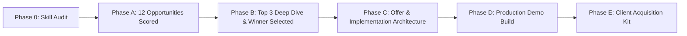

# Client-Conversion Intelligence & Portfolio Builder

**Author:** Software Engineer & B2B Solutions Strategist  
**Stack:** React, Next.js, TypeScript, Tailwind CSS  
**Target Market:** Private Businesses in India (Tier 1 & Tier 2) with Global Extensibility  
**Project Status:** Phase A Complete (Skill Discovery & Opportunity Scoring)

---

## 1. Directory Structure & Dossier Index

This directory contains the strategic intelligence, market research, scoring matrices, and sales playbooks required to build and monetize a top-tier client acquisition portfolio project:

| File | Purpose | Phase / Status |
| :--- | :--- | :--- |
| [`skill-execution-matrix.md`](./skill-execution-matrix.md) | Audit of installed marketing skills, execution status, and tool availability | Phase 0 — Complete |
| [`research-methodology.md`](./research-methodology.md) | Tri-tier evidence methodology (Facts, Inferences, Assumptions) and 100-pt scoring rubric | Phase 0 — Complete |
| [`opportunity-landscape.md`](./opportunity-landscape.md) | Deep breakdown of 12 commercial website/app categories evaluated across 12 criteria | Phase 1 — Complete |
| [`opportunity-scoring.csv`](./opportunity-scoring.csv) | Full quantitative ranking table across all 12 business categories | Phase 4 — Complete |
| [`finalist-comparisons.md`](./finalist-comparisons.md) | Deep dive into Top 3 Finalists: Private Schools, Boutique Resorts, Dental Clinics | Phase B — Complete |
| [`customer-and-competitor-research.md`](./customer-and-competitor-research.md) | Competitive dossiers, ERP vs agency gaps, and Voice-of-Customer mining | Phase B — Complete |
| [`winning-project-brief.md`](./winning-project-brief.md) | Single winning selection justification, compliance checks, and specs | Phase B — Complete |
| [`positioning-and-offer.md`](./positioning-and-offer.md) | Value equation, 3-tier commercial offer (INR/USD), and guarantee design | Phase C — Complete |
| [`pricing-hypotheses.md`](./pricing-hypotheses.md) | Pricing models, ROI math, unit economics, and scope boundaries | Phase C — Complete |
| [`seo-and-content-plan.md`](./seo-and-content-plan.md) | Search intent, keyword clustering, School schema, and Core Web Vitals | Phase C — Complete |
| `client-acquisition-playbook.md` | End-to-end sales workflow (Discovery → Outreach → Demo → Close) | Phase E — Upcoming |
| `outreach-templates.md` | Cold email, LinkedIn, WhatsApp, and objection handling talk tracks | Phase E — Upcoming |
| `lead-tracker-template.csv` | Prospect qualification schema and outreach tracking template | Phase E — Upcoming |
| `validation-experiment.md` | Initial 20-lead outreach experiment plan and feedback loop | Phase E — Upcoming |
| `implementation-notes.md` | Architectural decisions, reusable starter design system, and deployment | Phase D/E — Upcoming |

---

## 2. Phased Workflow Execution

- **Phase 0, A, B & C Complete:** We have identified the winning niche (**K-12 Private Schools Admissions & Parent Engagement Engine**), benchmarked real competitors, defined the 3-tier commercial offer, and detailed the technical, SEO, and pricing specifications.
- **Next Step:** Ready to begin **Phase D: Build the Approved Production Demo**!
