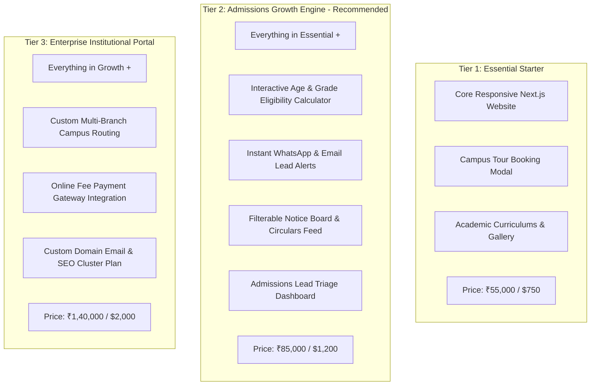

# Positioning, Commercial Offer & Value Architecture

**Project:** K-12 Private School Admissions & Parent Engagement Engine  
**Product Name:** `EduVanguard` / `Oakridge School Starter`  
**Standards:** Offers v1.0.1 (Hormozi Value Equation), Product Marketing v2.1.0  
**Date:** October 11, 2026  

---

## 1. Product Positioning & Value Proposition

### 1.1 The Core Positioning Anchor
- **For:** Chairpersons, Trustees, and Admissions Directors of independent private K-12 schools and pre-school academies.
- **Who:** Are losing high-value student enrollments because their slow, bloated legacy website causes 60–75% of prospective parents to abandon their research on mobile phones.
- **Our Solution Is:** A modern, high-performance **Admissions & Campus Tour Booking Engine**.
- **That Provides:** A sub-second mobile experience, an interactive child age-and-grade eligibility calculator, a 1-tap campus tour scheduler with automated WhatsApp/SMS confirmations, and a filterable parent notice board.
- **Unlike:** Legacy school ERP template portals (Edunext, Entab, Schoolpad) or generic agency WordPress themes that break Core Web Vitals and bury admissions details.
- **Our Platform:** Directs admissions inquiries directly to the admissions team in real time, increasing qualified campus tours and paying enrollments without any IT overhead.

---

## 2. The Hormozi Value Equation Applied to Education

```
              Dream Outcome (Full Admissions Quota + Prestigious Brand)  ×  Perceived Likelihood (Live Working Demo + CBSE/ICSE Compliance)
  Value  =  ──────────────────────────────────────────────────────────────────────────────────────────────────────────────────────────
              Time Delay (Live in 7–10 Days vs Agency's 3–6 Months)      ×  Effort & Sacrifice (Done-For-You Content Migration & Zero Staff Burden)
```

1. **Dream Outcome ↑:** Reaching 100% capacity in Pre-K, Grade 1, and Grade 11 admissions; projecting elite modern institutional prestige to prospective families.
2. **Perceived Likelihood of Achievement ↑:** Proven through a fully functioning live interactive prototype tailored to their school branding; standard CBSE/ICSE/Cambridge disclosure compliance built-in.
3. **Time Delay ↓:** Complete turnkey deployment within **7 to 10 days** (compared to traditional agencies taking 8 to 16 weeks).
4. **Effort & Sacrifice ↓:** 100% Done-For-You migration of their existing circulars, curriculum details, faculty lists, and campus photos. The school's front office staff has to do zero technical work.

---

## 3. The 3-Tier Commercial Offer Structure



### Tier 1: Essential Starter (₹55,000 INR / $750 USD)
*Best for: Single-branch preschools, primary schools, and boutique learning academies.*
- **Core Deliverables:**
  - Modern, mobile-first Next.js web application (up to 6 core pages: Home, About Us, Academics, Admissions, Campus Life, Contact).
  - 1-Tap Campus Tour & Inquiry Booking modal with email notification.
  - Interactive photo gallery showcasing classrooms, sports, and labs.
  - Faculty and leadership credentials section.
  - Google Map location, directions, and contact card.
  - Mobile speed optimization (<1.5s load times; passing Core Web Vitals).
  - Basic Local SEO setup and Google Business Profile linking.
- **Delivery Timeline:** 5 business days.

### Tier 2: Admissions Growth Engine — *RECOMMENDED* (₹85,000 INR / $1,200 USD)
*Best for: Established K-12 private schools (CBSE, ICSE, State Board) with 400–1,500 students.*
- **Core Deliverables (Everything in Essential, plus):**
  - **Interactive Child Age & Grade Eligibility Calculator:** Parents select child's DOB to automatically see matching grades, age criteria, and deadlines.
  - **Automated WhatsApp Lead Routing:** Inquiries trigger instant WhatsApp notifications to the admissions counselor.
  - **Live Filterable Notice Board & Circulars Feed:** Categorized announcements (Exams, Circulars, Admissions, Holidays) with downloadable PDF badges.
  - **Admissions Lead Triage Dashboard:** Lightweight, password-protected administrative view allowing school coordinators to review, filter, and export tour bookings.
  - **Tuition & Facilities Transparency Guide:** Clear, reassuring tuition range and scholarship breakdown.
  - Full Content Migration: We migrate all existing text, circulars, and photos from their old site.
- **Delivery Timeline:** 7–10 business days.

### Tier 3: Enterprise Institutional Portal (₹1,40,000 INR / $2,000 USD)
*Best for: Multi-branch school networks, international Cambridge/IB academies, and senior secondary colleges.*
- **Core Deliverables (Everything in Growth, plus):**
  - **Multi-Branch Campus Selector:** Routing inquiries and tour bookings to specific branch coordinators.
  - **Online Admission Fee / Application Form Payment Gateway:** Integration with Razorpay, Cashfree, or Stripe for online registration fees.
  - **Custom Scholarship & Sibling Discount Estimator.**
  - **Advanced Local & AI-SEO Cluster Package:** 5 dedicated local curriculum search landing pages and EducationalOrganization schema markup.
  - **Staff Training & Video SOPs:** 2 recorded training sessions for administrative staff on updating notices and exporting leads.
- **Delivery Timeline:** 14 business days.

---

## 4. What Is Explicitly Excluded (Scope Protection)

To protect delivery velocity and prevent scope creep:
- **Excluded:** Internal Student ERP systems (e.g., student attendance tracking, teacher grading books, report card generators, bus GPS tracking). *These remain inside the school's existing ERP portal; our website provides a clean external login link to their existing system.*
- **Excluded:** Custom photography or drone videography (the client must supply existing photos, or we curate licensed high-res editorial photography).
- **Excluded:** Direct legal compliance verification for board affiliations (the school provides their official affiliation certificate numbers).

---

## 5. Ongoing Maintenance & Retainer Model

- **Retainer Tier: "School Care & Admissions Growth" (₹6,000 / month INR or $90 / month USD)**
  - Weekly publication of school circulars, exam dates, and notices (school emails PDF/text, updated within 12 hours).
  - Event photo gallery uploads (sports day, annual day, science fair).
  - Monthly backup, SSL monitoring, and 99.9% uptime guarantee.
  - Seasonal admissions banner revamps (pre-academic year campaign).
  - Monthly admissions inquiry volume report sent to the Principal.
