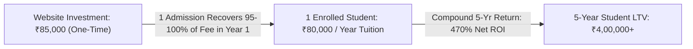

# Pricing Hypotheses, Unit Economics & ROI Architecture

**Project:** K-12 Private School Admissions & Parent Engagement Engine  
**Standards:** Pricing v1.0, Offers v1.0.1  
**Date:** October 11, 2026  

---

## 1. Unit Economics & Return on Investment (ROI) Math

The foundational premise of our sales conversation with school decision-makers is that **a modern website is an active asset that pays for itself with a single enrollment**.

### The ROI Calculation Presented to Trustees:
- **Average Private School Annual Tuition (Tier 1 & Tier 2 India):** ₹60,000 to ₹1,50,000 per student/year.
- **Average Enrollment Tenure per Student:** 5 to 10 years (Kindergarten through Grade 10/12).
- **Conservative Lifetime Value (LTV) per Student:** ₹3,50,000 to ₹12,00,000.
- **Cost of our Growth Engine Website:** **₹85,000** one-time implementation.
- **Breakeven Threshold:** **0.7 to 1.4 students**. If the modernized mobile website and instant campus tour scheduler secure just **2 additional students** who would have otherwise abandoned the application, the school achieves:
  - **Year 1 Net ROI:** 188% of the investment recovered in cash tuition.
  - **5-Year Compounded Return:** Over ₹8,00,000 in net lifetime tuition from a ₹85,000 digital asset.

---

## 2. Pricing Tiers & Package Comparison

| Dimension | Tier 1: Essential Starter | Tier 2: Admissions Growth Engine *(Hero)* | Tier 3: Enterprise Multi-Campus |
| :--- | :---: | :---: | :---: |
| **Price (India - INR)** | **₹55,000** | **₹85,000** | **₹1,40,000** |
| **Price (International - USD)** | **$750** | **$1,200** | **$2,000** |
| **Target Client** | Standalone Pre-K / Primary School (100–300 kids) | K-12 CBSE / ICSE Private School (400–1,500 kids) | Multi-Branch School Network / Cambridge Academy |
| **Delivery Timeline** | 5 business days | 7–10 business days | 14 business days |
| **Core Architecture** | Next.js, Tailwind, 6 pages | Next.js, Interactive Tour & Eligibility Calculator | Next.js, Multi-Campus Routing, Fee Gateway |
| **Admissions Lead Management** | Email Notifications | Email + Instant WhatsApp Routing + Lead Dashboard | Full Lead CRM export + Role-based permissions |
| **Content Migration** | Up to 10 circulars & photos | 100% Done-for-you old site migration | Full multi-campus archive migration |
| **Payment Terms** | 50% advance, 50% on live launch | 40% advance, 40% on staging review, 20% on launch | 40% advance, 30% milestone, 30% on launch |

---

## 3. Operating Cost & Infrastructure Breakdown (Solo Developer Margin)

One of the great advantages of modern frontend architecture is near-zero hosting and operational overhead:

| Infrastructure Component | Provider | Cost to Solo Developer | Billed to Client | Annual Gross Margin |
| :--- | :--- | :---: | :---: | :---: |
| **Frontend Web Hosting** | Vercel Pro or Cloudflare Pages | ₹0 – ₹1,600 / mo | Bundled in Retainer | 85%+ |
| **Custom Domain** | Cloudflare / Namecheap | ₹800 – ₹1,200 / year | Client owns directly | Pass-through |
| **Lead Notifications** | Resend (Email) + WhatsApp Webhooks | ₹0 (within free tiers) | Bundled in Retainer | 95%+ |
| **Content / Lead Storage**| Supabase or Serverless JSON | ₹0 (within generous free tier) | Bundled in Retainer | 100% |

**Net Margin per Project:**
- On a ₹85,000 implementation, developer direct expenses are under ₹2,500. **Net profit margin: ~97%**.
- On a ₹6,000/month recurring maintenance retainer, developer operational cost is <₹500/month. **Net monthly margin: ~90%**.

---

## 4. Scope Protection & Add-On Rate Card

To prevent the common pitfall of school clerks asking for endless custom database features:
- **Additional Custom Page:** ₹4,500 / page ($60).
- **Online Admission Fee Payment Gateway (Razorpay/Stripe):** ₹15,000 ($200).
- **Multi-Language Support (e.g., Hindi / Regional + English):** ₹18,000 ($250).
- **Virtual 360 Campus Tour Embed / Drone Video Hero:** ₹12,000 ($150).
- **Custom ERP Webhook Sync:** ₹20,000 ($275).

---

## 5. Pricing Validation Strategy for First 5 Clients

- **Founding Client Incentive (First 3 Clients Only):** Offer Tier 2 (Growth Engine) at ₹65,000 (₹20,000 discount) in exchange for:
  1. A signed video case study testimonial from the Principal.
  2. Public permission to display their before/after Core Web Vitals and admissions inquiry metrics in our portfolio.
  3. A written referral introduction to 2 fellow school trustees in their regional educational association.
