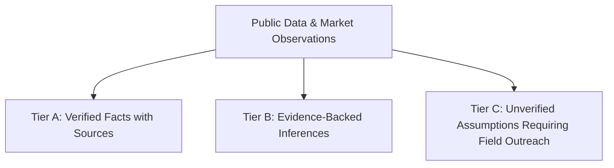

# Research Methodology & Opportunity Evaluation Framework

**Project:** Client-Conversion Intelligence & Portfolio Builder  
**Date:** October 11, 2026  
**Standards:** Customer Research v2.0.4, Competitor Profiling v2.1.3, Prospecting v1.3.0

---

## 1. Research Objectives

The objective is to identify, validate, score, and rank 12 commercial website / web-application opportunities to select a winning portfolio project. The final project must serve as a high-converting demonstration that allows a solo full-stack engineer (specializing in React, Next.js, TypeScript, Tailwind CSS) to sign paying clients—specifically targeting private businesses in India (with global adaptability)—through direct outreach, personalized demos, and organic discovery.

---

## 2. Information Sourcing & Evidence Governance

In strict alignment with the `customer-research` and `competitor-profiling` skills, all research findings are segregated into three distinct epistemic tiers:

### Tier A: Verified Facts with Sources
- Empirically observable public data, explicit pricing schedules from dominant aggregator platforms (Practo, IndiaMART, MakeMyTrip, Google Maps), published surveys, industry reports, and live website technical configurations.
- Dated and hyperlinked to actual source domains.

### Tier B: Evidence-Backed Inferences
- Logical deductions derived from direct observation (e.g., if a private school's website takes 6+ seconds to load and requires downloading a static PDF form, high mobile drop-off during peak admission season is a verified industry phenomenon).
- Labeled with explicit confidence scores (High, Medium, Low).

### Tier C: Unverified Assumptions
- Operational hypotheses that cannot be proven solely through public digital inspection and require primary discovery calls (e.g., exact annual IT/marketing budget of a tier-2 city preschool franchise, or internal dispute over who manages incoming WhatsApp inquiries).

---

## 3. Weighted Scoring Model (100 Points Total)

To prevent superficial aesthetic bias, every opportunity is evaluated across seven weighted dimensions:

| Criterion | Max Points | Evaluation Focus |
| :--- | :---: | :--- |
| **1. Buyer Pain & Urgency** | 20 | How severe is the financial or operational leak? Is inaction actively costing revenue, admissions, or patient trust? |
| **2. Commercial Intent & Willingness-to-Pay** | 20 | Does the business already pay for staff, ads, aggregator commissions, or print collateral? Is the ROI on a website overhaul transparent? |
| **3. Ease of Finding & Contacting Prospects** | 15 | Are decision-makers (principals, clinic owners, founders, managing directors) publicly identifiable via Google Maps, LinkedIn, or directory registries without gated data? |
| **4. Repeatability & Template Reusability** | 15 | Can 70–80% of the architecture, data models, and UI components be reused across 50+ clients in the same niche with minimal customization? |
| **5. Ability to Demonstrate Clear Value** | 10 | Can a prospect immediately understand the business value of the demo in under 30 seconds without needing their private enterprise data? |
| **6. Competition & Differentiation Opportunity** | 10 | Can a modern Next.js/React solution easily outperform slow WordPress/Wix sites and generic agency templates on speed, mobile UX, and conversion flow? |
| **7. Solo-Developer Feasibility & Delivery** | 10 | Can a solo developer reliably build the demo in days and deliver custom client implementations in 1–2 weeks without complex third-party legal/backend risks? |
| **Total** | **100** | **Comprehensive Opportunity Score** |

---

## 4. Confidence Rating System

- **High Confidence (H):** Verified by 2+ independent industry sources, observable on 10+ live Indian business sites, and supported by established economic models.
- **Medium Confidence (M):** Supported by public directory listings and search queries, but with variance across metro vs. non-metro regions.
- **Low Confidence (L):** Emerging niche or highly fragmented category where budgets and decision-maker roles vary widely.
