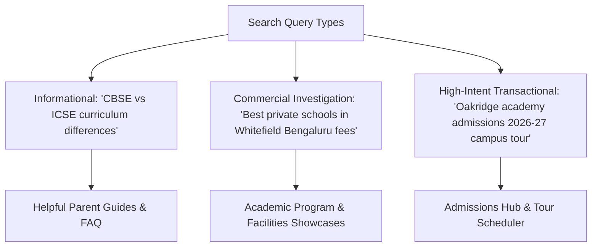

# SEO, Structured Data & AI Search Visibility Plan

**Project:** K-12 Private School Admissions & Parent Engagement Engine  
**Standards:** Schema v1.0, AI-SEO v1.0, Content Strategy v1.0, SEO Audit v1.0  
**Date:** October 11, 2026  

---

## 1. Search Intent Architecture & Keyword Taxonomy

Parents searching for private schools operate across three distinct stages of intent:



### 1.1 High-Intent Transactional Keywords (Conversion Target)
- `[School Name] admissions 2026-27`
- `[School Name] campus tour booking`
- `[School Name] fee structure Grade 1 to 10`
- `Apply for school admission [City / Neighborhood]`
- `CBSE school admission eligibility age cutoff [City]`

### 1.2 Commercial Investigation Keywords (Discovery Target)
- `Best CBSE schools in [Locality / City]`
- `Top private schools near me with sports facilities`
- `Pre-primary nursery admission open [Locality]`
- `International schools with Cambridge curriculum in [City]`

---

## 2. Technical SEO & Core Web Vitals Benchmarks

A foundational competitive advantage of our Next.js frontend over legacy WordPress sites is performance:

| Core Web Vital Metric | Target Benchmark | Legacy WordPress School Average | Our Next.js Engine Target |
| :--- | :---: | :---: | :---: |
| **Largest Contentful Paint (LCP)** | < 2.5s | 4.8s – 8.2s (Heavy uncompressed images) | **< 1.2s** (Next/Image WebP optimization) |
| **Interaction to Next Paint (INP)** | < 200ms | 350ms – 600ms (Heavy jQuery/sliders) | **< 80ms** (Clean React event handling) |
| **Cumulative Layout Shift (CLS)** | < 0.1 | 0.25 – 0.45 (Unstyled font shifts) | **< 0.02** (Strict aspect ratios & modern CSS) |
| **Mobile Friendliness Score** | 100/100 | Frequently fails tap targets | **100/100** (Mobile-first responsive UX) |

---

## 3. Structured Data (JSON-LD) Specification

Every deployed school website includes Google-compliant structured data for rich snippets in local search results:

### 3.1 `EducationalOrganization` / `School` Schema
```json
{
  "@context": "https://schema.org",
  "@type": "School",
  "name": "Oakridge International Academy",
  "url": "https://oakridge-academy-demo.vercel.app",
  "logo": "https://oakridge-academy-demo.vercel.app/logo.png",
  "image": "https://oakridge-academy-demo.vercel.app/campus.jpg",
  "description": "Premier CBSE and Cambridge affiliated K-12 private school fostering academic excellence, innovation, and holistic development.",
  "address": {
    "@type": "PostalAddress",
    "streetAddress": "Plot 42, Knowledge Park III",
    "addressLocality": "Bengaluru",
    "addressRegion": "Karnataka",
    "postalCode": "560066",
    "addressCountry": "IN"
  },
  "geo": {
    "@type": "GeoCoordinates",
    "latitude": 12.9716,
    "longitude": 77.5946
  },
  "telephone": "+91-80-2845-9900",
  "email": "admissions@oakridge-academy-demo.edu",
  "openingHoursSpecification": [
    {
      "@type": "OpeningHoursSpecification",
      "dayOfWeek": ["Monday", "Tuesday", "Wednesday", "Thursday", "Friday", "Saturday"],
      "opens": "08:00",
      "closes": "16:00"
    }
  ],
  "sameAs": [
    "https://facebook.com/oakridgeacademydemo",
    "https://instagram.com/oakridgeacademydemo",
    "https://linkedin.com/school/oakridgeacademydemo"
  ]
}
```

---

## 4. AI Search & Generative Engine Optimization (GEO)

With parents increasingly querying AI engines (*"Which schools in Whitefield offer good robotics labs and CBSE curriculum?"*), the site structure is optimized for AI extraction:
1. **Clear Entity Definitions:** Semantic HTML headings (`<h1>`, `<h2>`, `<h3>`) clearly distinguishing Affiliations (CBSE Affiliation No. 1930XXX), Grades Offered (Pre-K to Grade 12), and Student-Teacher Ratios (18:1).
2. **Direct Q&A Sections:** An extensive, accordion-style FAQ section directly answering the 8 most frequent parent questions (age requirements, bus transportation radius, fee installment schedules, scholarship criteria).
3. **Transparent Fact Sheets:** Key institutional statistics summarized in clean semantic markup tables for automated LLM citation.

---

## 5. Local Search & Google Business Profile (GBP) Synergy

The website is engineered to amplify the school's local Google Maps listing:
- Embedded interactive Google Map with click-to-navigate coordinates.
- Prominent display of verified Google Review ratings and review snippets.
- Direct CTA on the website encouraging enrolled parents to leave reviews on the school's Google Business Profile.
