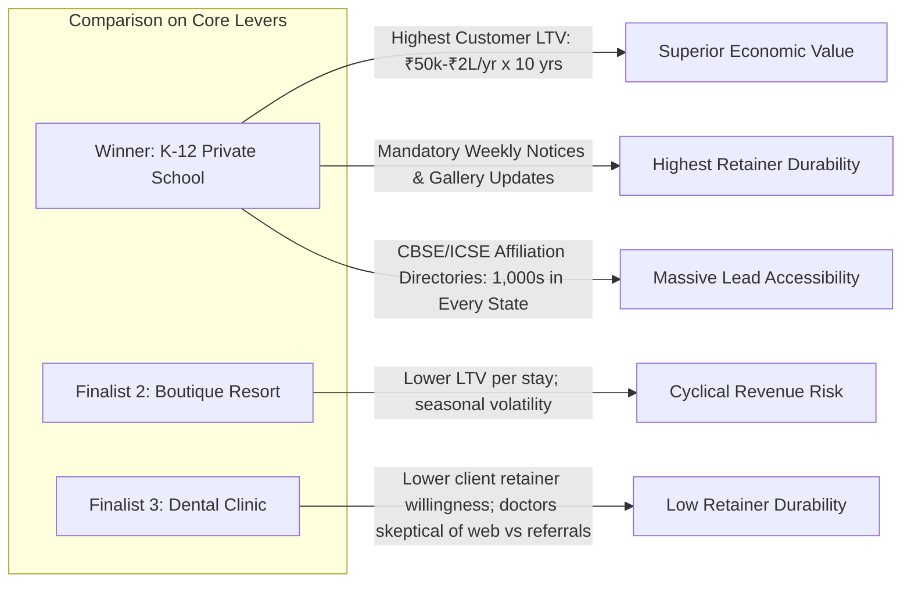

# Winning Project Brief: K-12 Private School Admissions & Parent Engagement Engine

**Project Codename:** `Apex Academy` / `Vanguard Global School` Starter  
**Category:** K-12 Private Schools, International Academies & Pre-School Networks  
**Target Market:** India (Tier 1 & Tier 2 Cities) with Global Extensibility (Private / Charter / International Schools)  
**Winning Score:** **93 / 100** (Rank #1 among 12 evaluated opportunities)  
**Date of Selection:** October 11, 2026  

---

## 1. Compliance with the 9 Mandatory Selection Conditions

| Condition | Verification & Evidence | Status |
| :--- | :--- | :---: |
| **1. Solves a real business problem** | Addresses the 60–75% parent drop-off during online school admission research. An unoccupied student seat represents ₹50,000–₹1,80,000+ in annual lost tuition. Increasing completed campus tour bookings directly boosts annual admissions revenue. | **PASSED** |
| **2. Understood in <30 seconds by nontechnical buyer** | Any school trustee or principal immediately grasps the 1-click value proposition: *"Instead of parents abandoning your site or calling busy receptionists, they check their child's grade eligibility, book a campus tour in 2 taps, and your admissions team receives an instant WhatsApp alert."* | **PASSED** |
| **3. Realistic target customer & identifiable decision-maker** | Independent private school Trustees, Chairpersons, and Admissions Directors are publicly identifiable on school websites, CBSE/ICSE registers, and LinkedIn. Direct phone numbers and administrative emails are public. | **PASSED** |
| **4. Achievable MVP by a solo developer** | High-performance React / Next.js / TypeScript / Tailwind CSS application with interactive tour booking, eligibility checker, notices feed, curriculum grids, and a lightweight admin inquiry management dashboard can be delivered within days. | **PASSED** |
| **5. Demonstrates excellent design & engineering ability** | Combines institutional prestige with ultra-responsive mobile performance (sub-second page transitions, accessible interactive components, elegant typography, filterable notice board, and clean stateful forms). | **PASSED** |
| **6. Reusable & customizable for multiple clients** | 85–90% of school website architectures are identical: hero, academic levels (Pre-K to 12), campus tour scheduler, facilities, admissions guide, faculty profiles, and public notice circulars. A single centralized config file drives colors, logos, text, and media. | **PASSED** |
| **7. Clear path from demonstration to paid engagement** | Prospect outreach includes an audit of their current slow site vs. the live demo: *"We built a working prototype of how your admissions flow could run on mobile."* One closed contract is worth ₹65,000–₹1,25,000 ($800–$1,500). | **PASSED** |
| **8. Credible maintenance & expansion opportunity** | Schools have continuous, mandatory operational publishing requirements: weekly/monthly circulars, examination date sheets, holiday notices, sports day galleries, and annual admission banners (generating ₹5,000–₹10,000/month recurring retainers). | **PASSED** |
| **9. No dependence on fabricated metrics or testimonials** | The value proposition rests entirely on observable UX friction, Core Web Vitals performance, and functional workflows (instant tour booking and eligibility check), with all sample data clearly identified as demonstration data. | **PASSED** |

---

## 2. Why the Winner Outperformed the Other Finalists

1. **Massive Lifetime Value (LTV) Advantage:**
   - A single enrolled student generates tuition across 5 to 10+ consecutive academic years (₹3 Lakhs to ₹15 Lakhs lifetime value per family). Convincing a school chairman that this platform will secure just 2–3 additional students easily justifies a ₹75,000+ investment.
   - For a boutique resort, a single booking is worth ₹15,000–₹35,000 once. For a dental clinic, an implant is worth ₹30,000–₹60,000. School economics are significantly larger.
2. **Superior Retainer Longevity:**
   - Schools *must* publish public notices, circulars, exam dates, fee deadlines, and event photo recaps weekly. Unlike dentists who rarely update their websites after launch, schools have an ongoing operational publishing requirement that makes monthly maintenance retainers (₹5,000–₹10,000/mo) standard and expected.
3. **Severe Competitive Vulnerability in the Target Market:**
   - 90%+ of independent private school websites in India are clunky, neglected WordPress or PHP sites built between 2012 and 2019 that fail Google mobile usability checks. The contrast between an existing school website and our modern Next.js engine is dramatic and immediately visible to trustees.

---

## 3. Disconfirmation Guardrails: What Evidence Would Invalidate This Decision?

We will immediately pivot to **Finalist 2 (Boutique Resorts & Homestays)** if our initial outreach experiments reveal any of the following:
1. **Decision Gridlock:** If school trust boards consistently require more than 6 weeks of multi-member committee approvals and bureaucratic RFP procedures, making rapid solo developer sales cycles unviable.
2. **Aggressive Bundling Lock-in:** If private schools are strictly prohibited by existing 5-year ERP contracts (e.g., Edunext or Entab) from operating an independent modern public marketing frontend.

*Mitigation:* Private schools routinely decouple their public marketing website from their internal administrative ERP login portal. Our solution acts as the **front-of-house Admissions & Brand Engine**, linking seamlessly to any existing third-party ERP via standard portal login links.

---

## 4. Product Specification & Demo Scope

### 4.1 Concept Identity: `Oakridge International Academy` (Working Demo Branding)
- **Tagline:** *Nurturing Inquiring Minds, Inspiring Global Leaders.*
- **Core Value Proposition:** *Holistic CBSE/Cambridge Education from Pre-K to Grade 12 with World-Class STEM Labs, Olympic-Standard Sports, and a 100% University Placement Record.*

### 4.2 Essential Workflows for the Demo
1. **Header & Navigation:**
   - Institutional branding, Academic Program dropdown, Admissions Hub, Campus Life, Parent Portal link, and prominent **"Book a Campus Tour"** CTA button.
2. **Hero Section:**
   - High-impact visual headline, key accreditation badges (CBSE / Cambridge / ISO), Quick Stats (100% Board Pass Rate, 18:1 Student-Teacher Ratio, 15-Acre Smart Campus), and dual CTAs: **Book Campus Tour** & **Check Eligibility**.
3. **Interactive Admissions Hub:**
   - **Interactive Age & Grade Eligibility Checker:** Parent selects child's Date of Birth to instantly see eligible grades (e.g., Nursery, Grade 1, Grade 6) and application deadlines.
   - **1-Tap Campus Tour Booking Modal:** Step-by-step interactive scheduling (Date, Time Slot, Grade of Interest, Parent Name, Phone/WhatsApp, Email).
   - **Interactive Tuition & Facilities Transparency Guide:** Clear tier guidelines for annual tuition, lab fees, transport, and scholarship opportunities.
4. **Academics & Curriculum Overview:**
   - Tabbed view across Pre-Primary, Primary, Middle School, and Senior Secondary (Grade 11–12 Science / Commerce / Humanities).
5. **Campus Life & Infrastructure Showcase:**
   - High-performance gallery showcasing Robotics Labs, Digital Library, Olympic Swimming Pool, Auditorium, and Indoor Sports Complex.
6. **Live Notice Board & Circulars Feed:**
   - Filterable feed with real-time category filtering (Admissions, Examinations, Circulars, Holiday Announcements) with simulated PDF downloads.
7. **Faculty & Leadership Credentials:**
   - Principal's Welcome Address and key Department Head credentials (clearly labeled as demonstration data).
8. **Interactive Admissions Lead Management Dashboard (Admin Demonstration):**
   - A realistic, client-facing Admin View accessible via a top demo toggle bar, showcasing incoming tour bookings, status filters (New, Tour Scheduled, Interviewed, Enrolled), search, and simulated export.
9. **Footer:**
   - Full institutional credentials, contact details, Google Map directions preview, mandatory affiliation disclosures, and legal notices.

---

## 5. Technology Stack & Architectural Principles

- **Framework:** Next.js (App Router), React, TypeScript.
- **Styling:** Tailwind CSS with a curated, premium design system (Deep Navy `#0F2042`, Warm Academic Amber/Gold `#D97706` / `#F59E0B`, Clean Slate Neutral `#F8FAFC`).
- **Icons & Motion:** Lucide React icons, smooth CSS micro-interactions, responsive drawer navigation.
- **Data Architecture:** Centralized config (`schoolConfig.ts`) driving 100% of the school's identity, contact information, navigation, programs, and notices, enabling 10-minute re-theming for new paying clients.
